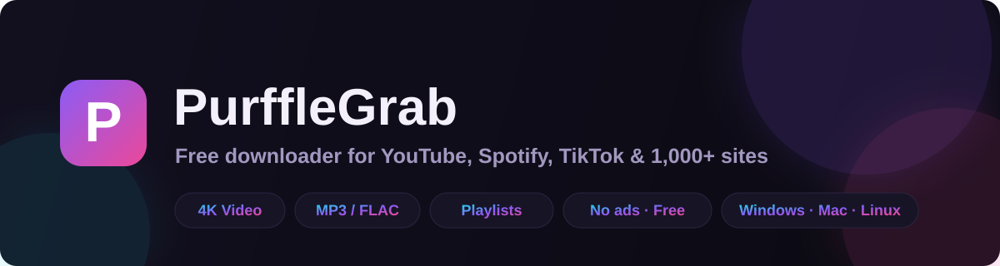
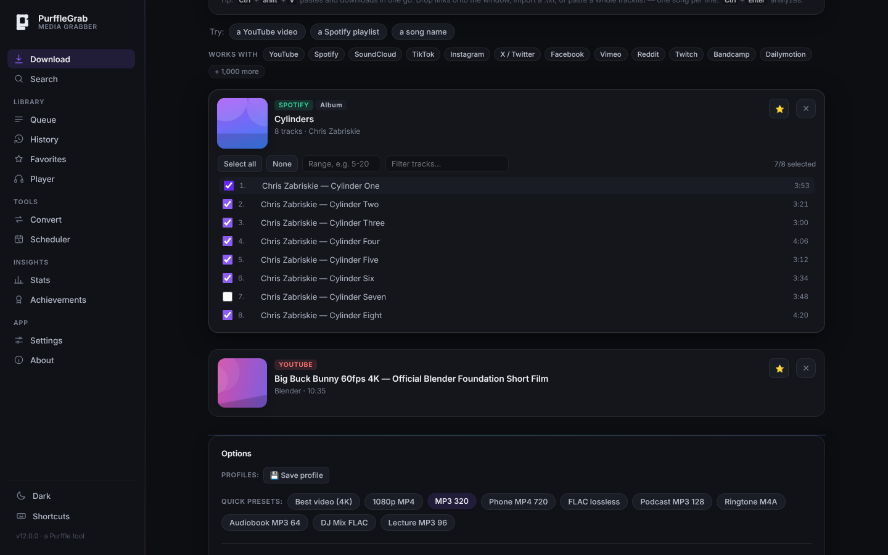
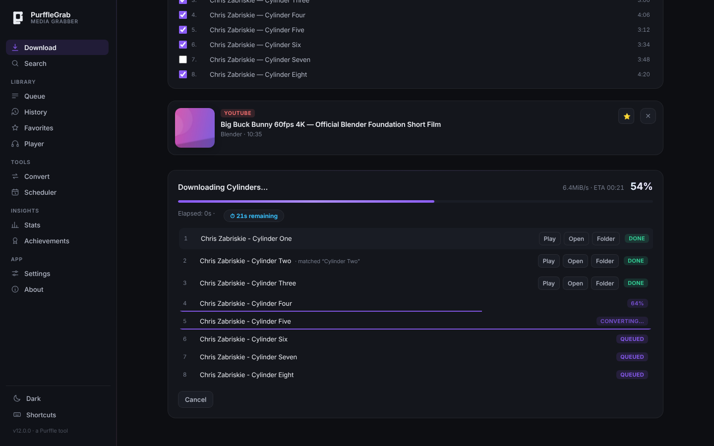
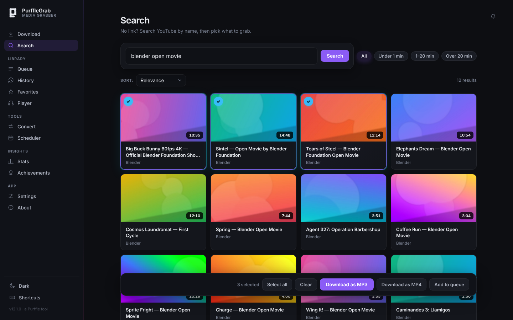
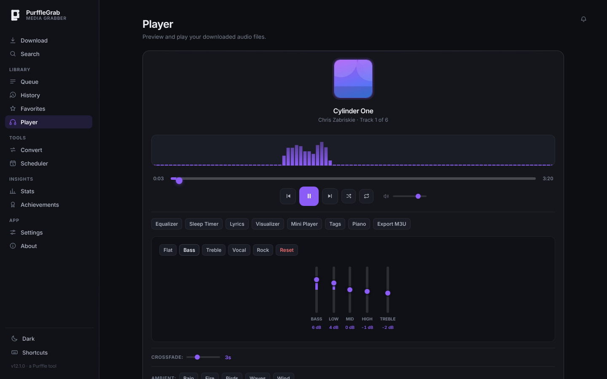
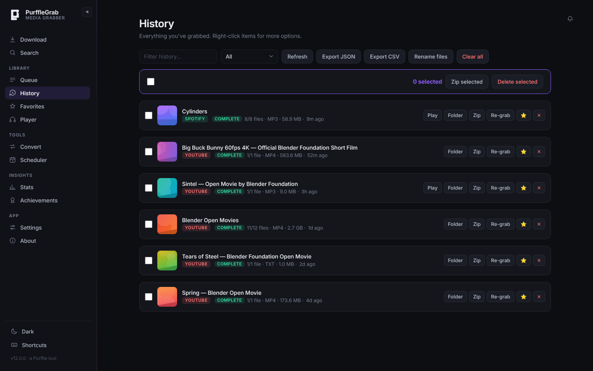
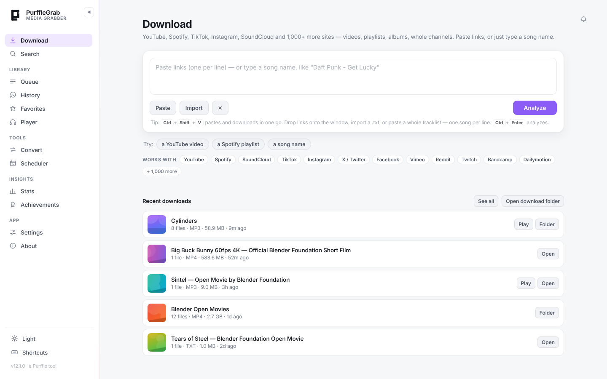

<div align="center">



# PurffleGrab — Free YouTube, Spotify, TikTok &amp; SoundCloud Downloader

**Download from YouTube, Spotify, TikTok, Instagram, SoundCloud and 1,000+ other sites as MP3, FLAC or up to 4K MP4.<br/>Free for Windows, Mac &amp; Linux — no ads, no account, and nothing leaves your computer.**

[](https://github.com/Chamanrajragu/purffle-grab/releases/latest)
[](https://github.com/Chamanrajragu/purffle-grab/releases/latest)
[](https://github.com/Chamanrajragu/purffle-grab/releases/latest)

[](https://github.com/Chamanrajragu/purffle-grab/releases/latest)
[](https://github.com/Chamanrajragu/purffle-grab/releases/latest)
[](https://github.com/Chamanrajragu/purffle-grab/stargazers)
[](https://github.com/Chamanrajragu/purffle-grab/releases/latest)
[](https://purffle.com/purffle-grab/)



</div>

---

**PurffleGrab** is a free desktop downloader for **YouTube, Spotify, TikTok, Instagram, SoundCloud and over a thousand other sites**.
Paste a link — or fifty, or just type a song name — pick a format, and press Download. Whole playlists, albums and
channels come down with cover art, tags and synced lyrics. **FFmpeg** and the **yt-dlp** engine are built in, and the
engine keeps itself up to date, so downloads keep working when sites change.

> 🎸 Made for putting your own music and videos on your phone, MP3 player or laptop — offline.

## ⬇️ Download

[](https://github.com/Chamanrajragu/purffle-grab/releases/latest)

| Your computer | Download | How to install |
|---|---|---|
| 🖥 **Windows 10 / 11** (64-bit) | **[Windows installer (.exe)](https://github.com/Chamanrajragu/purffle-grab/releases/latest)** | Run it. If SmartScreen appears: **More info → Run anyway** |
| 🍎 **Mac with Apple Silicon** (M1–M4, macOS 13+) | **[Mac — Apple Silicon (arm64.dmg)](https://github.com/Chamanrajragu/purffle-grab/releases/latest)** | Open the `.dmg` and drag PurffleGrab to Applications. First launch: **System Settings → Privacy &amp; Security → Open Anyway** ([details](#-troubleshooting)) |
| 🍎 **Mac with Intel** (macOS 13+) | **[Mac — Intel (x64.dmg)](https://github.com/Chamanrajragu/purffle-grab/releases/latest)** | Same as above. Not sure which Mac you have? **Apple menu → About This Mac** — “Chip: Apple M…” = Apple Silicon, “Processor: Intel” = Intel |
| 🐧 **Linux** (64-bit) | **[AppImage](https://github.com/Chamanrajragu/purffle-grab/releases/latest)** · **[.deb](https://github.com/Chamanrajragu/purffle-grab/releases/latest)** | AppImage: `chmod +x PurffleGrab-*.AppImage`, then run it. Debian / Ubuntu: `sudo apt install ./purfflegrab_*_amd64.deb` |

Every link opens the **[latest release](https://github.com/Chamanrajragu/purffle-grab/releases/latest)**. Scroll down to **Assets** and click the file for your computer —
on Windows that's `PurffleGrab.Setup.<version>.exe`. (The two “Source code” archives at the bottom are not the app.)
FFmpeg and yt-dlp are inside the installer, so there's nothing else to set up, and PurffleGrab tells you when an update is out.

## ✨ Why PurffleGrab

- **One app for every site** — YouTube, Spotify, TikTok, Instagram, SoundCloud, X, Vimeo, Facebook, Reddit, Twitch, Bandcamp and 1,000+ more.
- **No link? Type a song name.** Or paste a whole tracklist, one song per line — PurffleGrab finds the best match for each.
- **The right version of each song.** Spotify tracks are matched by length, title and artist, preferring official studio audio over live versions, covers and sped-up edits.
- **Real 4K.** Choose 4K or 1440p and get exactly that (not a quiet fallback to 1080p).
- **Playlists that stay in sync.** Grab a playlist again and only the songs added since come down — schedule it daily or weekly and your folder mirrors it.
- **Tidy files.** Cover art, artist, album, track number and year written into every song; playlists land in a folder named after them.
- **Keeps working.** The engine updates itself and retries with a fresh copy when a site changes.
- **Private.** No telemetry, no analytics, no ads, no account. Your downloads and history stay on your computer.

## 🌐 Supported sites

| Site | What you can download |
|---|---|
| **YouTube** | Videos, Shorts, playlists, whole channels — MP4 up to 4K, or MP3/M4A/FLAC audio; subtitles and transcripts |
| **Spotify** | Tracks, albums and playlists — matched to the best audio and saved as MP3/FLAC/M4A with cover art and tags |
| **TikTok** | Videos as MP4, or the sound as MP3 |
| **Instagram** | Reels and video posts (turn on browser cookies for posts that need a login) |
| **SoundCloud** | Tracks and sets as MP3, M4A or FLAC |
| **X / Twitter** | Videos from posts |
| **Facebook · Vimeo · Reddit · Dailymotion** | Public videos, with sound merged in |
| **Twitch** | Clips and past broadcasts |
| **Bandcamp · Mixcloud** | Streamable tracks, albums and mixes |
| **1,000+ more** | Anything the bundled [yt-dlp](https://github.com/yt-dlp/yt-dlp) engine supports — paste the link and see |

## 🚀 Features

### Downloading
| Feature | What it does |
|---|---|
| 📋 **Batch, drag &amp; drop** | Paste many links at once, drop them on the window, or import a `.txt` file. |
| 🔎 **Song names &amp; tracklists** | Type “Artist - Song”, or paste a list of songs — each is matched to its best upload, with alternatives one click away. |
| ✅ **Pick your tracks** | Tick exactly what you want from a playlist, album or channel — select all, a range like `5-20`, or filter by name. |
| ⚡ **Quick presets** | Best video (4K), 1080p MP4, MP3 320, Phone MP4 720, FLAC, Podcast, Ringtone, Audiobook. |
| 🎚 **Exact format picker** | See every resolution, codec and file size for a video and choose precisely. |
| 🔊 **Formats** | Audio: MP3, M4A, FLAC, WAV, Opus, OGG, AAC. Video: MP4 (H.264 up to 1080p, VP9 for 1440p/4K). |
| 🎤 **Synced lyrics** | Save time-synced `.lrc` lyrics next to each song (from the open [LRCLIB](https://lrclib.net) database). |
| 📝 **Transcripts** | Save a video's spoken text as clean `.txt`, with or without timestamps — even for a whole channel. |
| ⏩ **One-step download** | `Ctrl+Shift+V` (`⌘⇧V` on Mac) takes the link on your clipboard straight to a finished download. |
| 🔗 **Send from your browser** | A bookmarklet (in Settings) opens the page you're on directly in PurffleGrab. |

### Video &amp; audio extras
| Feature | What it does |
|---|---|
| 🚫 **SponsorBlock** | Cut sponsor segments, intros and outros from YouTube videos. |
| 💬 **Subtitles** | Download and embed subtitles in any language, including auto-generated ones. |
| ✂ **Clip / trim** | Download only part of a video, by start and end time. |
| 📖 **Chapters** | Embed chapter markers, or split a video into one file per chapter. |
| 🔈 **Normalise loudness** | Even out volume across a playlist. |
| 📁 **Artist / Album folders** | Sort downloads into folders automatically. |

### The app
| Feature | What it does |
|---|---|
| 🎧 **Music player** | Press **Play** the moment a download finishes. 5-band equaliser, visualiser, crossfade, synced lyrics, sleep timer. |
| 🔄 **Converter** | Convert many files at once between MP3, FLAC, M4A, WAV, Opus, OGG, MP4, MKV, WebM and MOV — or turn a clip into a GIF. |
| 🔁 **Playlist sync** | Re-grab a Spotify or YouTube playlist into the same folder and only **new songs** download — the rest are skipped in seconds, not re-fetched. |
| 📋 **Queue &amp; scheduler** | Line up downloads, or schedule them once, daily or weekly — a scheduled playlist becomes an automatic sync. Cancelled downloads **resume** where they stopped. |
| 🕘 **History** | Every download with its thumbnail, format and size — play, open, re-grab, zip or batch-rename. |
| 🛠 **Self-healing engine** | yt-dlp refreshes itself daily, and again automatically if a site changes mid-download. |
| 🍪 **Browser cookies &amp; proxy** | Fix age-restricted videos, “confirm you're not a bot” and login-only posts by using your browser's login — read locally, never uploaded. |
| 🎨 **Themes** | Dark, light and system, with accent colours and mood themes. |
| ⌨ **Keyboard first** | Command palette (`Ctrl+K` / `⌘K`), `Ctrl+1–9` / `⌘1–9` navigation, `?` for every shortcut. |

## 🆕 New in v12.1

- **Playlist sync** — grab the same playlist again and only the tracks added since are downloaded. Delete a song and the
  next sync brings it back. Schedule it daily or weekly and the folder stays mirrored to the playlist.
- **History knows** — a sync shows as *Up to date* or *12 new* instead of a wall of “already downloaded”.
- **Mac-native shortcuts** — `⌘K`, `⌘1–9`, `⌘⇧V` and friends (Ctrl still works), and Caps Lock no longer switches shortcuts off.
- **The equaliser remembers** your bands and presets between sessions, and the player skips files you've moved or deleted.
- **Clearer errors** when your connection or proxy is the problem, and audio-only sources in a video batch are saved as audio.
- Lots of polish: smoother seeking, dark-theme native controls, a quieter selection bar, unified favourites and more.

**v12** brought support for 1,000+ sites surfaced properly (TikTok, Instagram, SoundCloud…), download-by-song-name,
smarter Spotify matching, **real 4K/1440p**, synced lyrics, a self-healing engine with browser-cookie and proxy support,
tidy folders, instant Play, resume and batch conversion. **[Full changelog →](CHANGELOG.md)**

## 📸 Screenshots

<div align="center">






<br/><sub>Sample content: Blender open movies and Chris Zabriskie's <i>Cylinders</i> (Creative Commons).</sub>
</div>

## 🧭 How to use

1. **Paste a link** — or several, one per line. No link? Type a song name.
2. **Press Analyze.** PurffleGrab shows what it found; for playlists, tick the items you want.
3. **Pick a format** — Video or Audio, or a preset such as **MP3 320** or **1080p MP4**.
4. **Press Download.** Then **Play**, **Open**, or **Open folder**.

Files are saved to **Music › PurffleGrab** (change it in Settings). Single downloads go straight in; a playlist or album
gets its own folder.

**Tips:** `Ctrl+Shift+V` (`⌘⇧V` on Mac) pastes and downloads in one step · grab a playlist again to fetch only its new songs · copy a link in your browser and PurffleGrab offers to grab
it (with a one-click **MP3** button) · drop audio/video files on the window to convert them · press `?` for shortcuts.

## ⚖️ How it compares

| | PurffleGrab | Online converter sites | Browser extensions | Paid desktop downloaders |
|---|:-:|:-:|:-:|:-:|
| Price | **Free** | Free, with ads | Free / paid | Often $20–50+ |
| Ads, pop-ups, redirects | **None** | Many | Some | None |
| Spotify playlists | **✓** | Rarely | ✕ | Sometimes |
| TikTok, Instagram, SoundCloud… | **✓ 1,000+ sites** | A few | Usually one site | Varies |
| Whole playlists &amp; channels | **✓** | ✕ | Limited | ✓ |
| Playlist sync (only new songs) | **✓** | ✕ | ✕ | Rarely |
| Real 4K | **✓** | Rarely | Rarely | ✓ |
| Cover art, tags, synced lyrics | **✓** | ✕ | ✕ | Sometimes |
| Player, converter, scheduler | **✓** | ✕ | ✕ | Sometimes |
| Tracks you | **No** | Usually | Varies | Varies |

## 🛠 Troubleshooting

<details><summary><b>“Sign in to confirm you're not a bot” / “Too many requests”</b></summary>

YouTube sometimes asks for this after many requests. Waiting a few minutes usually clears it. For a lasting fix, open
**Settings → Downloads that need a login** and choose the browser you're signed in to YouTube with under **Use browser
cookies** — Firefox works most reliably. Cookies are read locally and never uploaded.
</details>

<details><summary><b>“This video is age-restricted” / members-only / Instagram “login required”</b></summary>

Same fix: turn on **Use browser cookies** in Settings, choosing a browser where you're signed in to that site. You can
also point PurffleGrab at an exported `cookies.txt` file.
</details>

<details><summary><b>Downloads suddenly fail, or “HTTP Error 403”</b></summary>

This almost always means the site changed. PurffleGrab refreshes its engine automatically when it sees this and
retries. You can also press **Settings → Download engine → Update engine**.
</details>

<details><summary><b>A Spotify playlist only shows 100 tracks</b></summary>

That's a limit of Spotify's public data. Add a free Spotify developer key under **Settings → Spotify** (it takes a
minute at developer.spotify.com) and your own playlists download in full. Spotify's own editorial playlists stay capped
at 100 — copy one into a playlist of your own to get all of it.
</details>

<details><summary><b>macOS says “Apple could not verify PurffleGrab” (or that it is “damaged”)</b></summary>

PurffleGrab isn't notarised by Apple (that needs a paid developer account), so macOS asks you to confirm it once:

1. Drag **PurffleGrab** to **Applications** and open it. Click **Done** on the warning.
2. Open **System Settings → Privacy & Security**, scroll down and click **Open Anyway** next to PurffleGrab, then confirm.

(On macOS 15 Sequoia and newer, right-click → Open no longer skips this step — use Open Anyway.)
Still blocked, or an older download says the app is “damaged”? Run this in Terminal, then open it again:

```bash
xattr -cr /Applications/PurffleGrab.app
```
</details>

<details><summary><b>Windows says “Windows protected your PC”</b></summary>

SmartScreen shows this for new apps that aren't code-signed. Click **More info → Run anyway**.
</details>

<details><summary><b>Something else?</b></summary>

[Open an issue](https://github.com/Chamanrajragu/purffle-grab/issues/new/choose) with your OS, the PurffleGrab version
(bottom of the sidebar) and the link that failed. The error shown in the app usually says exactly what went wrong.
</details>

## ❓ FAQ

<details><summary><b>Is PurffleGrab free?</b></summary>
Yes — free to download and use. No ads, no account, no subscription, no download limits.</details>

<details><summary><b>How do I download a Spotify playlist to MP3?</b></summary>
Copy the playlist link (Share → Copy link), paste it into PurffleGrab, press Analyze, choose <b>MP3 320</b>, untick
anything you don't want and press Download. Each track is saved with its title, artist, album and cover art.</details>

<details><summary><b>How does the Spotify download work?</b></summary>
Spotify's audio is DRM-protected, so PurffleGrab doesn't touch it. It reads the playlist's public track list, finds each
song's best-matching upload (scored on length, title and artist), downloads that audio and writes the Spotify
metadata and cover into the file — the same approach as tools like spotDL.</details>

<details><summary><b>Can I download TikTok videos or Instagram Reels?</b></summary>
Yes — paste the link and download as MP4 (or MP3 for the sound). Some Instagram posts need a login: turn on browser
cookies in Settings.</details>

<details><summary><b>Can it download YouTube videos in 4K?</b></summary>
Yes — choose the <b>Best video (4K)</b> preset or set the quality to 2160p. 1440p and 4K use YouTube's VP9 streams in an
MP4; 1080p and below use H.264 for maximum compatibility.</details>

<details><summary><b>Is the FLAC download really lossless?</b></summary>
FLAC is a lossless <i>format</i>, but YouTube and Spotify only stream compressed audio, so a FLAC made from them is a perfect
copy of that compressed source — not CD quality. For the smallest files with no audible difference, MP3 320 or M4A is
the better choice. The app says this where you pick the format.</details>

<details><summary><b>Does it work on Mac and Linux?</b></summary>
Yes. There are DMGs for Apple Silicon (M1–M4) and Intel Macs running macOS 13 Ventura or newer, and an AppImage and a
.deb for 64-bit Linux. Every platform gets the same features and the same self-updating engine.</details>

<details><summary><b>Do I need FFmpeg, Python or anything else?</b></summary>
No. FFmpeg and yt-dlp are bundled inside PurffleGrab.</details>

<details><summary><b>Does it collect any data?</b></summary>
No. There's no telemetry, analytics or tracking. PurffleGrab talks only to the sites whose links you paste, to GitHub to
check for updates, and — only if you ask for lyrics — to LRCLIB.</details>

<details><summary><b>Is PurffleGrab open source?</b></summary>
No. PurffleGrab is free to use (freeware): this repository publishes the ready-to-run installers under an
end-user <a href="LICENSE">licence</a>, and versions up to 9.0 were MIT-licensed. The engines it bundles, yt-dlp and
FFmpeg, are open source — see <a href="THIRD-PARTY-NOTICES.md">THIRD-PARTY-NOTICES.md</a>.</details>

## 🔒 Privacy

No telemetry, no analytics, no trackers, no ads, no account. Settings, history and downloads stay on your computer.
The app runs a small local server that only accepts connections from your own machine.

## ⭐ Help PurffleGrab grow

PurffleGrab is built and maintained by one developer. If it saved you time:

- **[Star the repo](https://github.com/Chamanrajragu/purffle-grab)** — it's the single biggest thing that helps other people find it.
- **Share it** with a friend who's still using a converter site full of ads.
- **[Report bugs or request features](https://github.com/Chamanrajragu/purffle-grab/issues/new/choose)** — every report gets read.

## ⚠️ Disclaimer

PurffleGrab is provided for **personal use** — for example your own uploads, Creative Commons and public-domain
material, and offline access to media you're licensed to keep. Downloading copyrighted content may violate the Terms of
Service of the platform concerned and copyright law in your country. **You are responsible for how you use this tool.**
The authors do not endorse piracy and accept no liability for misuse.

## 📄 Licence

PurffleGrab v10.0.0 and later are distributed under the [End User Licence Agreement](LICENSE). Versions up to 9.0.0 were
released under the MIT Licence, which remains in force for those versions.

Bundled components keep their own licences — including **FFmpeg (GPL v3)**, **yt-dlp (Unlicense)** and the **Inter**
typeface (SIL OFL). See [THIRD-PARTY-NOTICES.md](THIRD-PARTY-NOTICES.md), which includes a written offer for the FFmpeg
source.

Built with [Electron](https://www.electronjs.org/), [yt-dlp](https://github.com/yt-dlp/yt-dlp) and
[FFmpeg](https://ffmpeg.org/). A **[Purffle](https://purffle.com)** tool.

<sub>PurffleGrab is a free YouTube downloader, YouTube to MP3 and MP4 converter, Spotify playlist downloader and Spotify
to MP3 tool, TikTok and Instagram Reels downloader, SoundCloud downloader and Twitter video downloader for Windows,
macOS and Linux — a desktop alternative to online converter sites, with no ads and no tracking.</sub>

---

<!-- purffle-ecosystem -->
## 🧩 The Purffle Toolset

**PurffleGrab** is part of **[Purffle](https://purffle.com)** — a growing set of free tools.

| Tool | What it does |
|------|--------------|
| 🔄 **[Claude Multi](https://purffle.com/claude-multi/)** | Run Claude Code with multiple accounts — auto-switch on the 5-hour limit · paid app, from $5/month |
| 📐 **[Purffle Chartwright](https://purffle.com/purffle-chartwright/)** | Desktop chart analysis where the AI cannot invent a price |
| 🎵 **[PurffleGrab](https://github.com/Chamanrajragu/purffle-grab)** 👈 | Free downloader for YouTube, Spotify, TikTok &amp; 1,000+ sites |
| 🎥 **[PurffleVision](https://github.com/Chamanrajragu/purffle-vision)** | AI video creation — any topic to a finished video |
| ⚡ **[PurffleShorts](https://github.com/Chamanrajragu/purffle-shorts)** | Autonomous YouTube Shorts generator |
| 📈 **[PurffleTrader](https://github.com/Chamanrajragu/purffle-trader)** | Crypto paper-trading bot — Binance, EMA + RSI |
| 🤖 **[PurffleCopyBot](https://github.com/Chamanrajragu/purffle-copybot)** | Copy-trading bot — mirror top Hyperliquid traders |

<sub>🌐 [purffle.com](https://purffle.com) · 💼 by [Chaman Raj](https://github.com/Chamanrajragu)</sub>

---

## Need Something Like This Built for You?

I built this app solo. I also take on freelance work — fixed price, agreed before I start.

- **Custom AI chatbots** — trained on your own docs and FAQs, full source code, no monthly fee · *2–7 days*
- **Python automation** — file processing, data cleaning, scheduled reports, API work · *1–5 days*
- **Web scraping** — clean data as Excel, CSV, JSON or Sheets, plus the scraper itself · *1–4 days*
- **Excel and Google Sheets** — formulas, dashboards, macros, Apps Script · *1–4 days*

I only take work I can verify myself before delivering it. If I cannot check it, I will say so.

[](https://www.fiverr.com/purffle)
[](mailto:info@purffle.com)

More of what I have built: [purffle.com](https://purffle.com) · [purffle.tools](https://purffle.tools) · [purffleai.com](https://purffleai.com) · [purfflestudios.com](https://purfflestudios.com)
